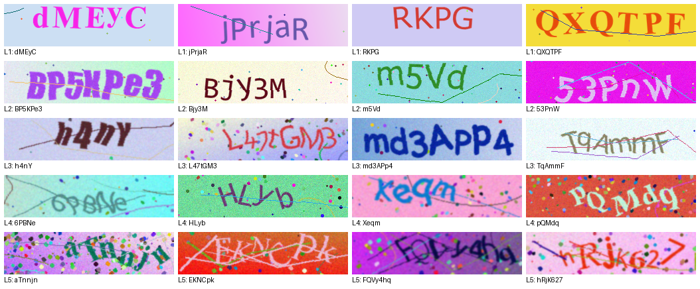
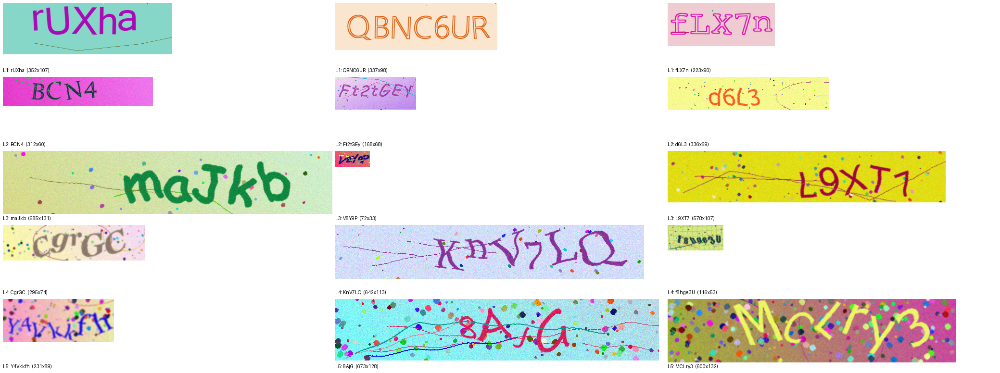

# Automated Captcha Testing

How strong is a text captcha against a trained neural network? This project builds the whole loop:
a **captcha generator** with five difficulty levels, a **CRNN + CTC model** that learns to read them,
a **local web API**, and a **Playwright end-to-end test** that solves captchas in a real browser and
reports the pass rate per difficulty. You can also **fine-tune the model on your own labeled captchas**
to measure how well your captcha holds up.



## Results

All numbers are exact-match accuracy (every character right) on held-out test sets. Splits are made
**by label text**, so the test set only contains strings the model never saw during training.

| Model | Test set | L1 | L2 | L3 | L4 | L5 | Overall | Char. error rate |
|---|---|---|---|---|---|---|---|---|
| `text_v1` – trained 30 epochs on 100k images | fixed 256×64 | 99.9% | 99.9% | 99.6% | 97.5% | 80.9% | 95.5% | 1.03% |
| `text_v1_ft` – fine-tuned on fresh generated images | fixed 256×64 | 99.9% | 99.9% | 99.6% | 98.8% | 87.2% | **97.0%** | 0.65% |
| `text_v1_ft` before size/style training | varied sizes & styles | 86.8% | 86.4% | 84.1% | 76.9% | 60.9% | 79.4% | 6.81% |
| `text_v2` – fine-tuned on varied sizes & styles | varied sizes & styles | 98.9% | 99.7% | 96.8% | 93.5% | 79.3% | **93.9%** | 1.62% |

**End to end** (Playwright opens the challenge page, the model reads the captcha, types and submits),
`text_v2`, 20 captchas per level:

| L1 | L2 | L3 | L4 | L5 | Overall |
|---|---|---|---|---|---|
| 100% | 100% | 95% | 95% | 90% | **96%** |

In other words: even level 5, which is hard for people to read, is solved 9 times out of 10. A plain
text captcha like this is not a serious obstacle for a trained model.

## How it works

### 1. Generator (`captchagen/generator.py`)

- **Text** (random strings, 4–7 characters) or **math** (`37+5`, `12×4`; the answer is stored too).
- Default charset leaves out look-alikes (`0/O`, `1/l/I`, `5/S`…), like most real captchas.
- **Difficulty 1–5** scales every effect together: per-character rotation, shear and overlap,
  mixed fonts, gradient backgrounds, dots, arcs, lines crossing the text (sometimes in the text's own
  color so they can't be filtered out by color), sine-wave warp, grain and blur.
- `--random-size` / `--style-variety`: canvases from ~60×32 to ~840×140, 29 extra italic and
  handwriting fonts, hollow / bold / thin letters, grid backgrounds.
- **Deterministic**: the same `(seed, index)` always gives the same image, so datasets are reproducible.



### 2. Data

- `generate_dataset.py` writes `images/`, `labels.csv` and `meta.json` (config + vocabulary).
- **Train/val/test split by a hash of the label text**, not by image. Splitting by image would put
  the same string in both train and test (just drawn differently) and make accuracy look better than
  it is.
- `OnTheFlyCaptchaDataset` renders fresh images during training: unlimited data, nothing on disk.
  Labels that hash into val/test are re-rolled, so training never sees test strings.

### 3. Model (`captchagen/model.py`)

A CRNN, ~10M parameters:

```
grayscale 64×256 → 7 conv blocks (BatchNorm, ReLU; later pools only shrink height)
                 → 512 features × 64 columns → 2-layer BiLSTM → per-column class scores → CTC
```

The image is read as a sequence of 64 columns from left to right, and **CTC loss** lines the
predicted characters up with the label, so labels of any length work without knowing where each
character is. Decoding is greedy (collapse repeats, drop blanks); the probability of that path is
returned as a **confidence score**.

### 4. Training (`train.py`)

- AdamW, OneCycle learning rate, mixed precision (CTC itself in fp32), gradient clipping.
- **Curriculum**: starts on level 1 and unlocks one level at a time over the first 30% of training.
- Per-level accuracy and character error rate every epoch; best and last checkpoints; final test run.
- `--resume` continues an interrupted run with optimizer and schedule state.

What moved the numbers:

| Change | Effect |
|---|---|
| Fine-tuning on **fresh generated images** instead of the fixed 90k disk set (`--on-the-fly`), sampling hard levels more (`--level-weights 1,1,2,3,4`) | Training loss had dropped to 0.01 while level 5 stalled at ~81%: the model was memorizing. With new images every epoch, level 5 went 80.9% → 87.2%. |
| **Aspect-preserving resize** (fit into 256×64, pad with the image's own border color) instead of stretching | 65.9% → 79.4% on varied-size images, with no retraining |
| Fine-tuning on **random sizes and styles** | 79.4% → 93.9% on varied-size images |

### 5. API and end-to-end test

- `server.py` (FastAPI, bound to `127.0.0.1`): an upload page (drag and drop, shows text and
  confidence), `POST /api/predict`, and `/challenge` – a captcha form served from the generator.
  Challenges are one-shot and expire after 5 minutes; uploads are limited in size and pixel count.
- `e2e_captcha_test.py`: Playwright opens `/challenge`, the model reads the image (or a screenshot of
  what the browser rendered with `--screenshot`), fills in the answer, submits, and records the result.

## Quick start

Python 3.11+ and a CUDA GPU recommended (an RTX 5060 trains `text_v1` in ~1h20m; CPU works for
inference).

```bash
pip install -r requirements.txt
python -m playwright install chromium
```

```bash
# Look at what the generator makes
python preview_captchas.py --random-size --style-variety

# Build a dataset and train
python generate_dataset.py --out data/text_v1 --count 100000
python train.py --data data/text_v1 --epochs 30

# Fine-tune on fresh, varied images (val/test still from disk)
python generate_dataset.py --out data/text_v2 --count 30000 --random-size --style-variety --seed 7
python train.py --data data/text_v2 --on-the-fly --init checkpoints/text_v1/best.pth \
    --level-weights 1,1,2,3,4 --curriculum 0 --epochs 20 --samples-per-epoch 60000 --lr 5e-4 --name text_v2

# Score, predict, serve, test
python evaluate.py checkpoints/text_v2/best.pth data/text_v2
python predict.py checkpoints/text_v2/best.pth some_captcha.png
python server.py                                   # http://127.0.0.1:8000
python e2e_captcha_test.py --start-server --rounds 20
```

## Fine-tune on your own captchas

Use this only for captchas **you own or are authorized to test** – for example to check how strong
your own site's captcha is.

1. **Label some images.** Name each file by its text (`AB12C.png`, or `AB12C_7.png` if texts repeat),
   or put a `labels.csv` with `filename,text` next to them. A few hundred is the minimum; 1000+ is
   much better.
2. **Import them:**
   ```bash
   python import_dataset.py --src my_captchas/ --out data/mine
   # --labels my_captchas/labels.csv   if labels are in a CSV
   # --case upper                      if your captcha isn't case-sensitive
   ```
   Any image size or format works. Splits are again by label (10% val, 10% test by default).
3. **See where you start:**
   ```bash
   python evaluate.py checkpoints/text_v2/best.pth data/mine
   ```
4. **Fine-tune:**
   ```bash
   python train.py --data data/mine --init checkpoints/text_v2/best.pth \
       --mix-synthetic 10000 --curriculum 0 --epochs 25 --lr 3e-4 --name mine
   ```
   - Characters the base model doesn't know (e.g. `0`, `O`, `1`) are **added to the vocabulary**
     automatically: the output layer gets new rows, everything else keeps what it learned.
   - `--mix-synthetic` adds generated images to every epoch so a small labeled set isn't just memorized.
5. **Use it:** `python predict.py checkpoints/mine/best.pth ...`, or
   `CAPTCHA_MODEL=checkpoints/mine/best.pth python server.py`.

**Demo** – 2,000 captchas in a style the model was never trained on (full alphanumeric charset with
16 unseen characters, 200×70), 1,611 used for training:

| | Their test set | Our varied test set |
|---|---|---|
| `text_v2` before fine-tuning | 18.2% | 93.9% |
| after 25 epochs (~25 min) with `--mix-synthetic 10000` | **80.8%** | 94.0% |

The model learned the new style without forgetting the old one. Almost all remaining errors are
look-alikes (`l`↔`1`↔`I`, `O`↔`0`↔`o`) and upper/lower-case pairs (`w`↔`W`, `s`↔`S`) – exactly why
captchas usually leave those characters out. If yours aren't case-sensitive, import with
`--case upper`.

## Project layout

```
captchagen/
  generator.py      captcha rendering, difficulty 1–5, sizes & styles
  datasets.py       disk + on-the-fly datasets, vocab, CTC batching
  preprocess.py     aspect-preserving resize shared by training, prediction and the API
  model.py          CRNN, greedy CTC decoding, confidence
  metrics.py        exact-match accuracy, character error rate
  splits.py         train/val/test by label hash
generate_dataset.py build a dataset with the generator
import_dataset.py   turn your own labeled images into a dataset
train.py            train / fine-tune / resume
evaluate.py         per-level accuracy of any checkpoint on any dataset
predict.py          read images from the command line
server.py, web/     local API, upload page, challenge page
e2e_captcha_test.py Playwright pass-rate test
```

## Limitations

- The model knows the captcha styles it was trained on. Captchas from other generators fail until it
  is fine-tuned on labeled examples of them.
- Greedy decoding only; a beam search or a language model wouldn't help much on random strings anyway.
- `/api/verify` returns the correct answer after a wrong guess – useful for testing, not for production.
